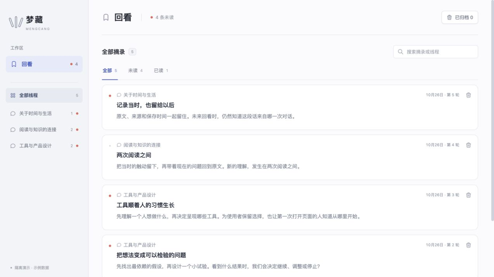

# 回看 · Huikan

**把 AI 对话中值得留下的内容，变成以后找得到、看得懂、能继续使用的资料。**

回看是一个以本机保存为核心的 AI 对话留存与回看工具。当前重点是 DeepSeek Harness 接入，后续推进 Codex 适配与用户可定制组件。



## 已有能力

- 从支持的 DeepSeek Harness 对话中主动保存整条消息或选中文字，保留原文和来源。
- 按来源线程浏览，搜索摘录，记录已读状态。
- 重复内容去重、失败重试、归档与恢复。
- Electron 浮窗和便签，以及来源回跳的插件接口。
- 设置中自动识别本机 Harness，提供配套插件安装按钮与真实握手状态。
- 主动保存后在本机识别代码、链接、待办清单和长文，推荐对应组件。
- 保存与内容特征识别通过本机完成，不需要额外的模型请求。

可选的 AI 主题整理复用 Harness 配置的模型服务，会把待整理摘录发送给该服务。公开版默认使用 Electron 浮窗；本机历史原生浮窗的独立二进制与宿主 Harness 运行时不包含在仓库中。

**阶段：早期开发版。** 当前验证以 macOS Apple Silicon 为主；可构建预览安装包，尚无 Developer ID 签名与 Apple 公证。内容识别使用本机规则，完整 Codex 留存适配、开放组件接口与社区组件分享属于后续计划，详见 [发展计划](docs/ROADMAP.md)。

## 下载安装

[**下载 macOS Apple Silicon 预览包（0.2.0）**](https://github.com/Rabbitgenius-rgb/huikan/releases/download/v0.2.0/Huikan-0.2.0-mac-arm64.zip) · [发行说明与全部附件](https://github.com/Rabbitgenius-rgb/huikan/releases/tag/v0.2.0)

适用于 M 系列芯片 Mac。下载 ZIP 后解压，将“回看.app”移到“应用程序”目录，再打开使用；配套 Harness 插件已内置，无需另行下载源码或安装 Node.js。首次连接步骤见下文“接入 DeepSeek Harness”。

当前为开发预览包，尚无 Developer ID 签名与 Apple 公证，macOS 可能阻止打开；尚未完成干净机器安装验证。Intel Mac 与 Windows 安装包暂未提供。

### Mac 首次打开

如果第一次打开时提示“无法验证开发者”或“Apple 无法检查其是否包含恶意软件”，请先确认文件来自本项目的 GitHub 发行页，再按以下步骤操作：

1. 使用访达解压 ZIP，将“回看.app”移到“应用程序”目录，并尝试打开一次。
2. 如果被系统拦截，进入 **系统设置 → 隐私与安全性**，在“安全性”区域找到回看对应的提示，点击 **仍要打开**。
3. 按系统提示确认，再打开回看；系统可能要求由你本人输入登录密码或使用 Touch ID。

这是针对该应用的一次确认，具体操作参见 [Apple 官方说明](https://support.apple.com/zh-cn/102445)。

已对 GitHub 公开下载的原始 ZIP 进行本机复查：独立资料目录中工作台和浮窗启动、示例摘录保存、重启后原文恢复均通过。这不等同于其他 Mac 的首次安装验证。

## 快速体验界面

需要 Node.js 22 或更新版本、npm。

```sh
git clone https://github.com/Rabbitgenius-rgb/huikan.git
cd huikan
npm --prefix ui ci
npm --prefix ui run dev
```

打开终端显示的本机地址。默认是空工作台；添加 `?demo=1` 可体验独立示例数据。示例使用独立存储身份，不导入正式摘录。

## 运行桌面工作台和浮窗

```sh
npm ci
npm --prefix ui ci
npm run build
npm start
```

工作台会自动准备配套浮窗，无需再手动启动第二个程序。只有调试独立浮窗时才使用 `npm run companion`。

开发启动器把桌面资料、浮窗缓存与桥接分别放在仓库 `.local/` 下，默认与已有安装版资料隔离。它们都被 Git 忽略，不应上传。

## 接入 DeepSeek Harness

当前适配 `0.2.0-rc.2`、`0.2.1-rc.3`，其他版本会明确拒绝留存。构建、打包和宿主配置说明见 [插件文档](harness-plugin/README.md)。

首次使用：

1. 打开一次 DeepSeek Harness，完成宿主初始化，然后正常退出。
2. 打开回看左下角的 **连接与识别设置**，确认识别到的 Harness 版本；不在常见目录时可选择应用。
3. 点击 **安装 / 更新回看插件**。回看使用 Harness 自带的官方安装器安装内置插件包，安装过程可能需要网络。
4. 重新打开 Harness 并启用回看插件，打开对话；设置显示“已连接”后即可留作回看。

之后回看会自动发布本机发现信息，插件自动跟随正在运行的回看，无需填写目录或连接地址。已有的插件显式 `bridgeDirectory` 配置、`MENGCANG_RECALL_BRIDGE_DIR` 环境变量仍优先；若旧配置指向其他实例，应先移除旧配置或统一路径。

“已检测到 Harness”只说明找到应用；“已连接”还要求支持版本的插件心跳与工作台就绪。回看不会读取账号、密钥或完整会话文件来识别软件。普通留存不要求模型密钥；可选主题整理使用宿主已有模型配置。

## 内容识别与组件

设置中可分别控制内容识别和组件建议。它们只处理你主动保存的摘录，不改写原文。闭合的 Markdown 代码块、网页链接、`- [ ]` / `- [x]` 清单和长文会获得对应标签；阅读时可以展开代码、链接或清单组件。清单目前是原文的只读呈现，通用文本和长文提供阅读建议。

这不是模型语义分类，识别准确性受原文格式影响；自定义组件、开发者组件接口与组件分享仍在计划中。

## 构建 macOS 预览包

在 macOS 上安装依赖后运行：

```sh
npm run package:mac
```

输出为仓库旁 `huikan-release/Huikan-0.2.0-mac-arm64.zip`。解压后将“回看.app”放到应用目录即可试用。当前仅提供 Apple Silicon 构建脚本和本机临时签名，尚未完成干净机器安装验证、Developer ID 签名与 Apple 公证，不应视作正式稳定发行。

## 正式签名与 Apple 公证

当前公开下载的 0.2.0 仍为未公证预览包。正式公证流程已提供构建入口，但需要发布者先开通 Apple Developer Program，并在本机配置有效的 **Developer ID Application** 发布证书；Apple Development 测试证书不适用于此流程。

公证凭据只保存在 macOS 钥匙串中。在本机终端运行 `xcrun notarytool store-credentials huikan-notary`，由发布者在交互提示中完成账号、公证凭据与开发团队的配置。不要把密码、私钥或公证凭据写入源码、发布附件或 GitHub 日志。

```sh
export HUIKAN_NOTARY_PROFILE=huikan-notary
npm run package:mac:check
npm run package:mac:release
```

如果本机有多个发布证书，还需用 `HUIKAN_SIGN_IDENTITY` 指定其中一个证书标识。检查命令只核对本机证书与配置名称，不代表 Apple 已接受公证或已验证账号授权。

正式流程使用安全时间戳、Hardened Runtime 和 Electron 所需的 JIT 权限，签名失败即停止；完成 Apple 公证、附加公证票据后，必须通过签名、票据和 Gatekeeper 检查，才会输出 ZIP。默认输出在 `huikan-release/notarized/`，避免覆盖现有预览包。只有实际公证通过并完成下载启动验证后，才应更新公开下载附件和“已公证”状态。

依据：[Apple 公证要求](https://developer.apple.com/documentation/security/notarizing-macos-software-before-distribution)、[开发者会员注册](https://developer.apple.com/programs/enroll/)、[Electron 公证工具](https://github.com/electron/notarize)。

## 开发与测试

```sh
npm test
npm run build
```

根目录测试不依赖 Harness 运行时，覆盖事务、去重、归档恢复、请求来源、退出保存、连接发现与内容识别。插件的宿主集成测试另外需要对应版本的 Harness SDK，见插件文档。

| 目录 | 内容 |
| --- | --- |
| `ui/` | React 回看工作台与兼容存储模块 |
| `desktop/` | Electron 桌面入口与本机桥接 |
| `harness-plugin/` | Harness Host / Client 插件 |
| `companion/` | Electron 浮窗与便签 |
| `shared/`、`core/` | 本机通信和来源协议 |
| `tests/` | 保存、来源、恢复与退出回归检查 |

连接方式见 [架构说明](docs/ARCHITECTURE.md)。欢迎通过 Issue 和 Pull Request 参与，见 [贡献说明](CONTRIBUTING.md)。

## 开源许可

项目源码采用 [MIT License](LICENSE)。第三方组件保留其各自许可，见 [第三方声明](THIRD_PARTY_NOTICES.md)。
