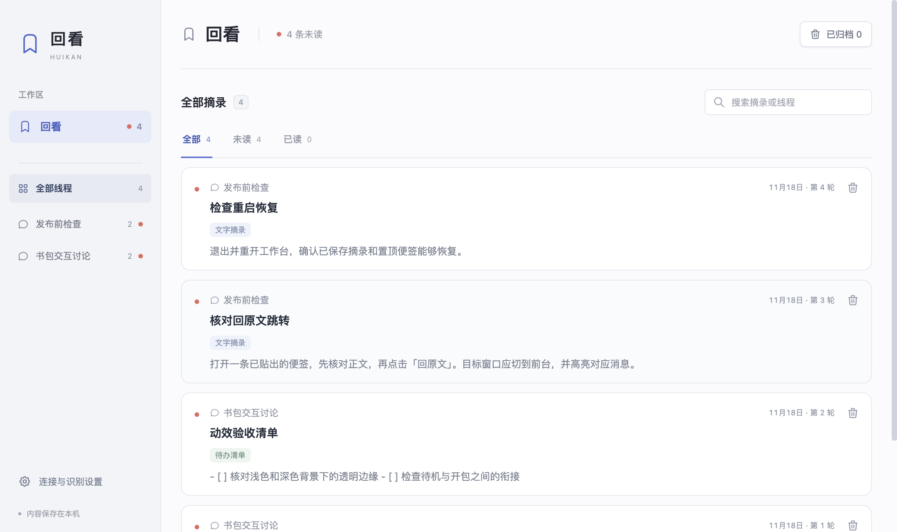
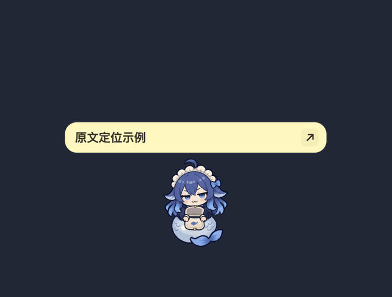
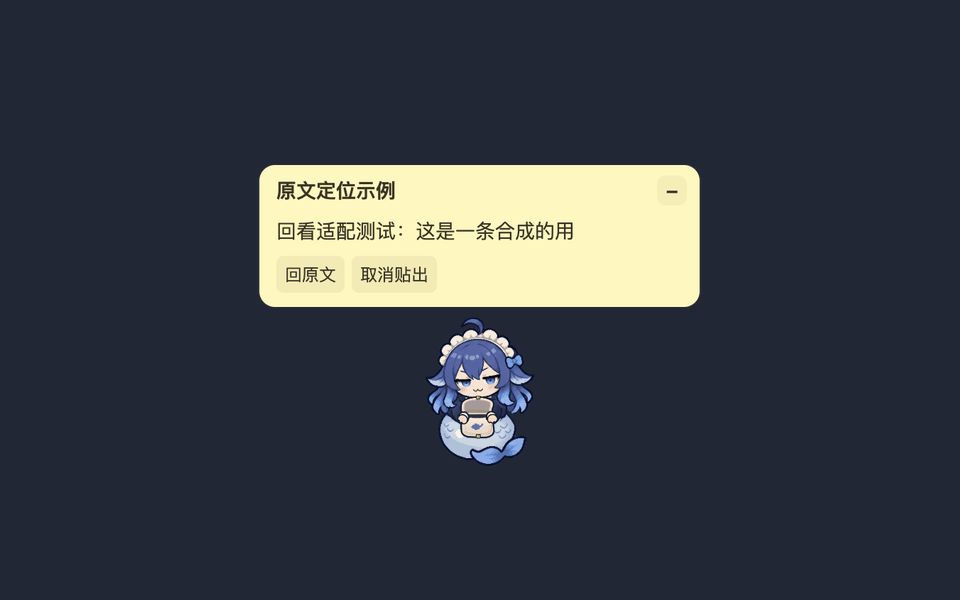
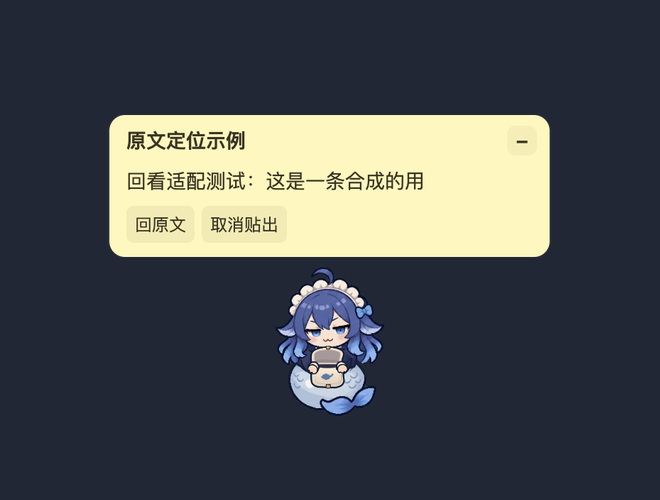
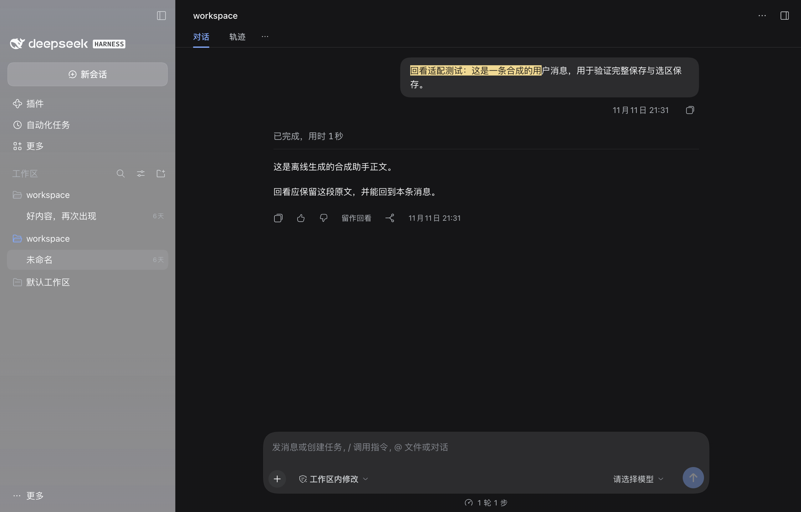

# 回看 · Huikan

**把 AI 对话中值得留下的内容，变成以后找得到、看得懂、能继续使用的资料。**

回看是一个以本机保存为核心的 AI 对话留存与回看工具。当前主线专注 DeepSeek Harness 插件；Codex 本机 MCP 作为暂存适配独立保留，默认关闭。后续推进用户可定制组件。

## 下载安装

| 平台 | 当前预览版 | 安装包 | 发行说明 |
| --- | --- | --- | --- |
| macOS（Apple Silicon） | 0.3.16 | [下载 ZIP](https://github.com/Rabbitgenius-rgb/huikan/releases/download/v0.3.16/Huikan-0.3.16-mac-arm64.zip) | [Mac 0.3.16](https://github.com/Rabbitgenius-rgb/huikan/releases/tag/v0.3.16) |
| Windows 10/11（x64） | 0.3.1 | [下载安装程序](https://github.com/Rabbitgenius-rgb/huikan/releases/download/v0.3.1/Huikan-0.3.1-windows-x64-setup.exe) | [Windows 0.3.1](https://github.com/Rabbitgenius-rgb/huikan/releases/tag/v0.3.1) |

Mac 版解压后将「回看.app」移到「应用程序」。Windows 版按安装向导操作。安装包已内置工作台和回看插件，无需额外安装 Node.js。搭配 Harness 使用时，请完成 [插件安装或更新](#接入-deepseek-harness)。

[下载 0.3.16 完整项目资料包](https://github.com/Rabbitgenius-rgb/huikan/releases/download/v0.3.16/Huikan-0.3.16-project-kit.zip) · [历史版本记录](docs/RELEASE_HISTORY.md)

### Mac 首次打开

Mac 预览包使用临时签名。若首次打开时被 macOS 拦截，请确认文件来自上表的 GitHub 发行页，尝试打开一次，再到 **系统设置 → 隐私与安全性** 点击 **仍要打开**，按系统提示确认。详见 [Apple 官方说明](https://support.apple.com/zh-cn/102445)。Windows 安装包尚未签名，首次运行可能出现 SmartScreen 或「未知发布者」提示。



## 书包便签演示

| 大肥鱼开包与合包 | 展开便签阅读 |
| --- | --- |
|  |  |

点击便签里的「回原文」，对应的 Harness 窗口会切到前台并高亮原消息或选区。



<details>
<summary>大肥鱼的待机与小动作</summary>


[查看完整 GIF（16 段动作，约 35 秒）](docs/previews/v0.3.16/whale-idle-actions.gif)

</details>

<details>
<summary>查看浅黄色标签、便签正文和原文高亮截图</summary>

| 书包标签 | 便签正文 |
| --- | --- |
|  |  |



</details>

## 已有能力

- 从支持的 DeepSeek Harness 对话中主动保存整条消息或选中文字，保留原文和来源。
- 按来源线程浏览，搜索摘录，记录已读状态。
- 重复内容去重、失败重试、归档与恢复。
- 按主题浏览的 Electron 浮窗、完整原文预览和黄色便签，以及来源回跳的插件接口。Windows 11 22H2 以上支持系统 Acrylic 毛玻璃。
- Windows 自动识别已安装的 Harness 并安装内置插件；macOS 提供识别和安装按钮，连接状态以实际握手为准。
- 主动保存后在本机识别代码、链接、待办清单和长文，推荐对应组件。
- 保存与内容特征识别通过本机完成，不需要额外的模型请求。

打开浮窗只读取自定主题和本机已有的主题缓存；尚未归类的摘录集中显示在“待整理内容”。点击“整理主题”并确认后，才会使用 Harness 配置的模型服务处理待整理摘录。该操作会把这些摘录发送给模型服务。Codex 来源不发送给 Harness 模型，使用自定主题或“待整理内容”。公开版默认使用 Electron 浮窗；本机历史原生浮窗的独立二进制与宿主 Harness 运行时不包含在仓库中。

**阶段：早期开发版。** 提供 macOS Apple Silicon 与 Windows x64 预览构建；Windows 版尚未做代码签名，Mac 版尚无 Developer ID 签名与公证。内容识别使用本机规则，开放组件接口与社区组件分享属于后续计划，详见 [发展计划](docs/ROADMAP.md)。

## 浮窗在 Windows 与 Mac 上的显示

当前源码按主题组织摘录。主浮窗为 320 × 400，按主题显示；悬停或点击主题后，在独立浮窗查看简介和完整摘录，再从正文拖出黄色便签。已贴出的便签收在同一只大肥鱼的书包里，打开书包后点击浅黄色标签即可阅读。Mac 从菜单栏打开，Windows 从系统托盘或 `Ctrl+Shift+K` 打开。来源轮次仅在内部保留，供回到原文使用。

0.2.3 起，Windows 的回看面板和原文预览使用系统 Desktop Acrylic，预览同步浮窗的颜色和透明度。原生毛玻璃要求 Windows 11 22H2（build 22621）及以上；Windows 10、旧版 Windows 11、系统减少透明度或高对比度模式采用实色背景。系统省电、远程会话或硬件环境也可能使材质退化为实色。支持范围见 [Electron 系统材质说明](https://www.electronjs.org/docs/latest/api/base-window#winsetbackgroundmaterialmaterial-windows)。

Mac 使用系统 vibrancy；字体、圆角和材质由各自系统绘制，不能保证逐像素相同。黄色便签保持原有纸面。GitHub 中的旧版安装包仍保留原来的界面；请以具体版本的发行说明为准。

## 快速体验界面

需要 Node.js 22 或更新版本、npm。

```sh
git clone https://github.com/Rabbitgenius-rgb/huikan.git
cd huikan
npm --prefix ui ci
npm --prefix ui run dev
```

打开终端显示的本机地址。默认是空工作台；添加 `?demo=1` 可体验独立示例数据。示例使用独立存储身份，不导入正式摘录。

## 运行桌面工作台和浮窗

Mac 桌面构建还需要 Xcode Command Line Tools，用于编译本机快捷键占用检测程序；安装后的应用无需安装这些工具。

```sh
npm ci
npm --prefix ui ci
npm run build
npm start
```

工作台会自动准备配套浮窗，无需再手动启动第二个程序。只有调试独立浮窗时才使用 `npm run companion`。

开发启动器把桌面资料、浮窗缓存与桥接分别放在仓库 `.local/` 下，默认与已有安装版资料隔离。它们都被 Git 忽略，不应上传。

## 暂存的其他接入

Codex 适配已退出默认构建、设置和连接流程，单独保存在 [codex-plugin/](codex-plugin/README.md)。已有摘录继续保留原文和来源。

## 接入 DeepSeek Harness

已实测版本包括 `0.2.0-rc.2`、`0.2.1-rc.3`、`0.2.2-rc.1` 和 `0.2.2-rc.3`；其他版本会自动检查接口与消息结构，通过后连接，失败时明确提示。构建、打包和宿主配置说明见 [插件文档](harness-plugin/README.md)。

### Windows 首次使用

1. 安装 [DeepSeek Harness 官方桌面版](https://www.deepseek.com/download/)，打开一次完成初始化，再完全退出 Harness。
2. 安装并打开回看。回看会检查常用目录和当前用户的安装记录，自动安装内置插件；自定义位置可在设置中选择 `DeepSeek Harness.exe`。
3. 设置提示安装完成后，点击 **打开 Harness**。实际插件握手成功后显示“已连接”，即可在对话中留作回看。

如果 Harness 正在运行，回看会等你完全退出后再安装。已有同版、新版、开发链接或被停用的回看插件会保留；停用的插件需在 Harness 中自行启用。安装失败时可在设置里重新检测重试。关闭“启动时自动连接”会停止后台安装检查。账号登录和模型服务配置仍在 Harness 中完成。

### macOS 首次使用

1. 打开一次 DeepSeek Harness，完成宿主初始化，然后正常退出。
2. 打开回看左下角的 **连接与识别设置**，确认识别到的 Harness 版本；不在常见目录时可选择应用。
3. 点击 **安装 / 更新回看插件**。回看使用 Harness 自带的官方安装器安装内置插件包，安装过程可能需要网络。
4. 重新打开 Harness 并启用回看插件，然后打开一段对话。连接状态显示「已连接」后，即可留作回看。

使用 Mac 0.3.16 的「回原文」前，请用上述步骤更新到随包提供的回看插件 `0.3.4`。更新后完全退出并重新打开 Harness，新插件才会生效。

之后回看会自动发布本机发现信息，插件自动跟随正在运行的回看，无需填写目录或连接地址。已有的插件显式 `bridgeDirectory` 配置、`MENGCANG_RECALL_BRIDGE_DIR` 环境变量仍优先；若旧配置指向其他实例，应先移除旧配置或统一路径。

“已检测到 Harness”只说明找到应用；“已连接”还要求支持版本的插件心跳与工作台就绪。回看不会读取账号、密钥或完整会话文件来识别软件。普通留存不要求模型密钥；可选主题整理使用宿主已有模型配置。

## 内容识别与组件

设置中可分别控制内容识别和组件建议。它们只处理你主动保存的摘录，不改写原文。闭合的 Markdown 代码块、网页链接、`- [ ]` / `- [x]` 清单和长文会获得对应标签；阅读时可以展开代码、链接或清单组件。清单目前是原文的只读呈现，通用文本和长文提供阅读建议。

这不是模型语义分类，识别准确性受原文格式影响；自定义组件、开发者组件接口与组件分享仍在计划中。

## 构建 Windows 预览包

在 Windows 上安装根目录及 `ui/` 依赖后运行：

```sh
npm run package:win
```

输出为仓库旁 `huikan-release/windows/Huikan-0.3.1-windows-x64-setup.exe`。GitHub 仓库的 **Actions → Build Windows → Run workflow** 会在 Windows 环境中运行测试、构建 NSIS 安装程序、实际安装，并启动安装后的程序检查摘录保存、关窗留后台、系统快捷键、托盘菜单和重启恢复；另外安装固定版本的官方 Harness，检查初始化、自动安装和插件连接；检查成功后在运行附件中提供安装程序和配套插件。工作流不会自动发布新的 Release。

## 构建 macOS 预览包

在 macOS 上安装依赖后运行：

```sh
npm run package:mac
```

输出为仓库旁 `huikan-release/Huikan-<版本>-mac-arm64.zip`。解压后将“回看.app”放到应用目录即可试用。Mac 构建脚本当前仅面向 Apple Silicon，使用本机临时签名，尚未完成干净机器安装验证、Developer ID 签名与 Apple 公证，不应视作正式稳定发行。

预览发布工作流会解压生成的 ZIP，校验应用签名，再用独立资料目录启动工作台和浮窗，检查保存、重复保存及重启恢复。以上检查通过后才会上传安装包。

解压后可在本机重复运行启动检查。

```sh
node scripts/smoke-packaged.cjs "/绝对路径/回看.app/Contents/MacOS/Huikan"
```

验证书包的「回原文」时，在官方 Harness 中用测试对话保存一段选区并贴成便签。在 Harness 居于后台、关窗后，以及页面重载期间各点击一次「回原文」，检查窗口是否回到前台并高亮原选区。

Mac 图标源文件为 `desktop/assets/icon.svg`，系统图标为 `desktop/assets/icon.icns`。如需重新生成，运行 `swift scripts/create-app-icon.swift /tmp/huikan.iconset`，再运行 `iconutil -c icns /tmp/huikan.iconset -o desktop/assets/icon.icns`。

## 正式签名与 Apple 公证

当前公开下载的 Mac 版仍为未公证预览包。正式公证流程已提供构建入口，但需要发布者先开通 Apple Developer Program，并在本机配置有效的 **Developer ID Application** 发布证书；Apple Development 测试证书不适用于此流程。

公证凭据只保存在 macOS 钥匙串中。在本机终端运行 `xcrun notarytool store-credentials huikan-notary`，由发布者在交互提示中完成账号、公证凭据与开发团队的配置。不要把密码、私钥或公证凭据写入源码、发布附件或 GitHub 日志。

```sh
export HUIKAN_NOTARY_PROFILE=huikan-notary
npm run package:mac:check
npm run package:mac:release
```

如果本机有多个发布证书，还需用 `HUIKAN_SIGN_IDENTITY` 指定其中一个证书标识。检查命令只核对本机证书与配置名称，不代表 Apple 已接受公证或已验证账号授权。

正式流程使用安全时间戳、Hardened Runtime 和 Electron 所需的 JIT 权限，签名失败即停止；完成 Apple 公证、附加公证票据后，必须通过签名、票据和 Gatekeeper 检查，才会输出 ZIP。默认输出在 `huikan-release/notarized/`，避免覆盖现有预览包。只有实际公证通过并完成下载启动验证后，才应更新公开下载附件和“已公证”状态。

依据：[Apple 公证要求](https://developer.apple.com/documentation/security/notarizing-macos-software-before-distribution)、[开发者会员注册](https://developer.apple.com/programs/enroll/)、[Electron 公证工具](https://github.com/electron/notarize)。

## 开发与测试

```sh
npm test
npm run build
```

根目录测试不依赖 Harness 运行时，覆盖事务、去重、归档恢复、请求来源、退出保存、连接发现与内容识别。插件的宿主集成测试另外需要对应版本的 Harness SDK，见插件文档。

| 目录 | 内容 |
| --- | --- |
| `ui/` | React 回看工作台与兼容存储模块 |
| `desktop/` | Electron 桌面入口与本机桥接 |
| `harness-plugin/` | Harness Host / Client 插件 |
| `codex-plugin/` | 默认关闭的 Codex 暂存适配及独立回归入口 |
| `companion/` | Electron 浮窗与便签 |
| `shared/`、`core/` | 本机通信和来源协议 |
| `tests/` | 保存、来源、恢复与退出回归检查 |

连接方式见 [架构说明](docs/ARCHITECTURE.md)。欢迎通过 Issue 和 Pull Request 参与，见 [贡献说明](CONTRIBUTING.md)。

## 开源许可

项目源码采用 [MIT License](LICENSE)。第三方组件保留其各自许可，见 [第三方声明](THIRD_PARTY_NOTICES.md)。
