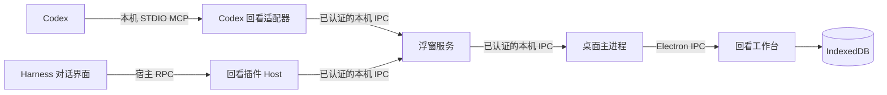

# 连接方式与数据边界

普通留存由用户触发，携带原文、来源与请求 ID。工作台在一个存储事务中保存记录和回执；重试按请求识别，正文去重保留首次收藏的来源和阅读状态。归档隐藏条目，保留恢复能力。

本机桥接在 macOS/Linux 使用 Unix Socket，在 Windows 使用命名管道。连接使用同用户目录权限和随机认证凭据，运行文件不属于仓库内容。可选主题整理通过 Harness 已配置的模型服务处理摘录，因此该步骤有独立的模型数据发送与费用边界。

Electron 浮窗只按主题呈现摘录。自定主题和已缓存的模型主题在本机合并，尚未归类的原文显示在“待整理内容”；来源中的轮次字段继续保留，供定位原文使用。打开浮窗不触发模型请求；用户点击“整理主题”并确认后才发送待整理摘录。切换对话会关闭旧主题预览，异步主题结果不会覆盖新对话。

该公开版本聚焦回看。旧存储结构中的部分兼容模块保留，以避免导入旧记录时丢失字段；它们不代表资料库、画布或风格库页面已经开放。用户可定制组件见发展计划。

## 启动与发现

桌面程序自动准备自有浮窗，发布仅当前用户可读取的本机发现文件。插件检查目录权限、协议和发布进程存活状态后定位桥接；实际连接状态还要求插件心跳和工作台已准备好。拥有子进程的工作台正常退出时先排空保存，再关闭自己的浮窗和发现文件；父进程断开时配套浮窗也会正常退出。显式旧路径配置保留优先级。

设置持久化在桌面资料目录的 `huikan-settings-v1.json`；浏览器演示使用独立设置键。内容类型和组件建议由已保存正文即时派生，不写回正文、不调用模型。当前代码、链接与清单组件仅作为阅读视图，开放组件接口尚未提供。

Windows 首次接入由回看主进程检测官方 Harness 的安装记录、应用标识和版本；确认宿主已初始化且没有运行后，通过其自带运行环境和官方插件管理器安装内置插件。不会要求系统 Node/npm，不修改其他插件，也不会强制退出宿主。检测和状态查询不会触发反复安装，失败后等待显式重试；自定义安装位置由用户选择后保存。真实连接仍以插件心跳为准。

## Codex 来源与连接

Codex MCP 服务独立于工作台窗口运行，通过 `ELECTRON_RUN_AS_NODE=1` 复用安装包内置的 Node 运行环境，避免依赖 GUI 进程的标准输出。握手完成后才发布 Codex 心跳；连接状态与 Harness 分开。每次保存或显式切换都携带调用方提供的技术线程 ID，服务不从进程启动环境、聊天标题或最近文件猜当前对话。只读查询不切换浮窗。

Codex 来源使用独立 `codex:` 实例命名空间，保存原文和回执继续走现有资料库事务；没有消息锚点时不伪造轮次或选区。回跳构造经过验证的 `codex://threads/<id>`，不走 Harness 导航。Codex 摘录不会转送到 Harness 模型。

设置中的连接按钮只写带回看标记的 MCP 配置块，保留其他文本并拒绝未知同名项。它不绕过 Codex 的工具许可策略，也不会自动信任生命周期 hooks。
