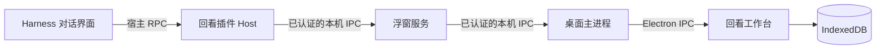

# 连接方式与数据边界

普通留存由用户触发，携带原文、来源与请求 ID。工作台在一个存储事务中保存记录和回执；重试按请求识别，正文去重保留首次收藏的来源和阅读状态。归档隐藏条目，保留恢复能力。

本机桥接在 macOS/Linux 使用 Unix Socket，在 Windows 使用命名管道。连接使用同用户目录权限和随机认证凭据，运行文件不属于仓库内容。可选主题整理通过 Harness 已配置的模型服务处理摘录，因此该步骤有独立的模型数据发送与费用边界。

该公开版本聚焦回看。旧存储结构中的部分兼容模块保留，以避免导入旧记录时丢失字段；它们不代表资料库、画布或风格库页面已经开放。Codex 接入与用户可定制组件见发展计划。

## 启动与发现

桌面程序自动准备自有浮窗，发布仅当前用户可读取的本机发现文件。插件检查目录权限、协议和发布进程存活状态后定位桥接；实际连接状态还要求插件心跳和工作台已准备好。拥有子进程的工作台正常退出时先排空保存，再关闭自己的浮窗和发现文件；父进程断开时配套浮窗也会正常退出。显式旧路径配置保留优先级。

设置持久化在桌面资料目录的 `huikan-settings-v1.json`；浏览器演示使用独立设置键。内容类型和组件建议由已保存正文即时派生，不写回正文、不调用模型。当前代码、链接与清单组件仅作为阅读视图，开放组件接口尚未提供。
