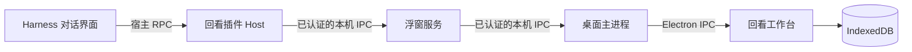

# 连接方式与数据边界

普通留存由用户触发，携带原文、来源与请求 ID。工作台在一个存储事务中保存记录和回执；重试按请求识别，正文去重保留首次收藏的来源和阅读状态。归档隐藏条目，保留恢复能力。

本机桥接在 macOS/Linux 使用 Unix Socket，在 Windows 使用命名管道。连接使用同用户目录权限和随机认证凭据，运行文件不属于仓库内容。可选主题整理通过 Harness 已配置的模型服务处理摘录，因此该步骤有独立的模型数据发送与费用边界。

Electron 浮窗只按主题呈现摘录。自定主题和已缓存的模型主题在本机合并，尚未归类的原文显示在“待整理内容”；来源中的轮次字段继续保留，供定位原文使用。打开浮窗不触发模型请求；用户点击“整理主题”并确认后才发送待整理摘录。切换对话会关闭旧主题预览，异步主题结果不会覆盖新对话。

该公开版本聚焦回看。旧存储结构中的部分兼容模块保留，以避免导入旧记录时丢失字段；它们不代表资料库、画布或风格库页面已经开放。用户可定制组件见发展计划。

## 启动与发现

桌面程序自动准备自有浮窗，发布仅当前用户可读取的本机发现文件。插件检查目录权限、协议和发布进程存活状态后定位桥接；实际连接状态还要求插件心跳和工作台已准备好。拥有子进程的工作台正常退出时先排空保存，再关闭自己的浮窗和发现文件；父进程断开时配套浮窗也会正常退出。显式旧路径配置保留优先级。

设置持久化在桌面资料目录的 `huikan-settings-v1.json`；浏览器演示使用独立设置键。内容类型和组件建议由已保存正文即时派生，不写回正文、不调用模型。当前代码、链接与清单组件仅作为阅读视图，开放组件接口尚未提供。

Windows 首次接入由回看主进程检测官方 Harness 的安装记录、应用标识和版本；确认宿主已初始化且没有运行后，通过其自带运行环境和官方插件管理器安装内置插件。不会要求系统 Node/npm，不修改其他插件，也不会强制退出宿主。检测和状态查询不会触发反复安装，失败后等待显式重试；自定义安装位置由用户选择后保存。真实连接仍以插件心跳为准。

## 暂存适配与历史资料兼容

当前默认构建只启用 DeepSeek Harness。Codex 的独立源码和历史接入步骤保存在 `codex-plugin/`，默认不显示设置入口、不注册配置安装 IPC、不发布 Codex 心跳/上下文处理器，也不打包 `codex-mcp.cjs`。桌面主进程和浮窗均拒绝新的 Codex 保存；历史待保存请求暂停，不能绕过主入口自动重试。

旧资料的 Codex 来源校验、原文读取与首次来源去重兼容继续保留；不会迁移、删除或重写历史来源。旧 Codex 选中状态不会作为 Harness 主浮窗的活动对话；已有资料也不会转送给 Harness 模型。现有全局 Codex MCP 配置和已发布安装包不由源码构建自动修改。

`npm test` 验证 Harness 主线及隔离边界；`npm run test:codex` 单独验证暂存适配。仅在显式设置 `HUIKAN_ENABLE_CODEX=1` 后构建时包含 Codex；打包产物将启用状态写成固定配置，运行环境不能临时开启默认包中隔离的适配。
