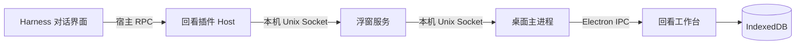

# 连接方式与数据边界

普通留存由用户触发，携带原文、来源与请求 ID。工作台在一个存储事务中保存记录和回执；重试按请求识别，正文去重保留首次收藏的来源和阅读状态。归档隐藏条目，保留恢复能力。

本机桥接使用同用户目录权限和随机认证凭据，运行文件不属于仓库内容。可选主题整理通过 Harness 已配置的模型服务处理摘录，因此该步骤有独立的模型数据发送与费用边界。

该公开版本聚焦回看。旧存储结构中的部分兼容模块保留，以避免导入旧记录时丢失字段；它们不代表资料库、画布或风格库页面已经开放。Codex 接入与用户可定制组件见发展计划。
